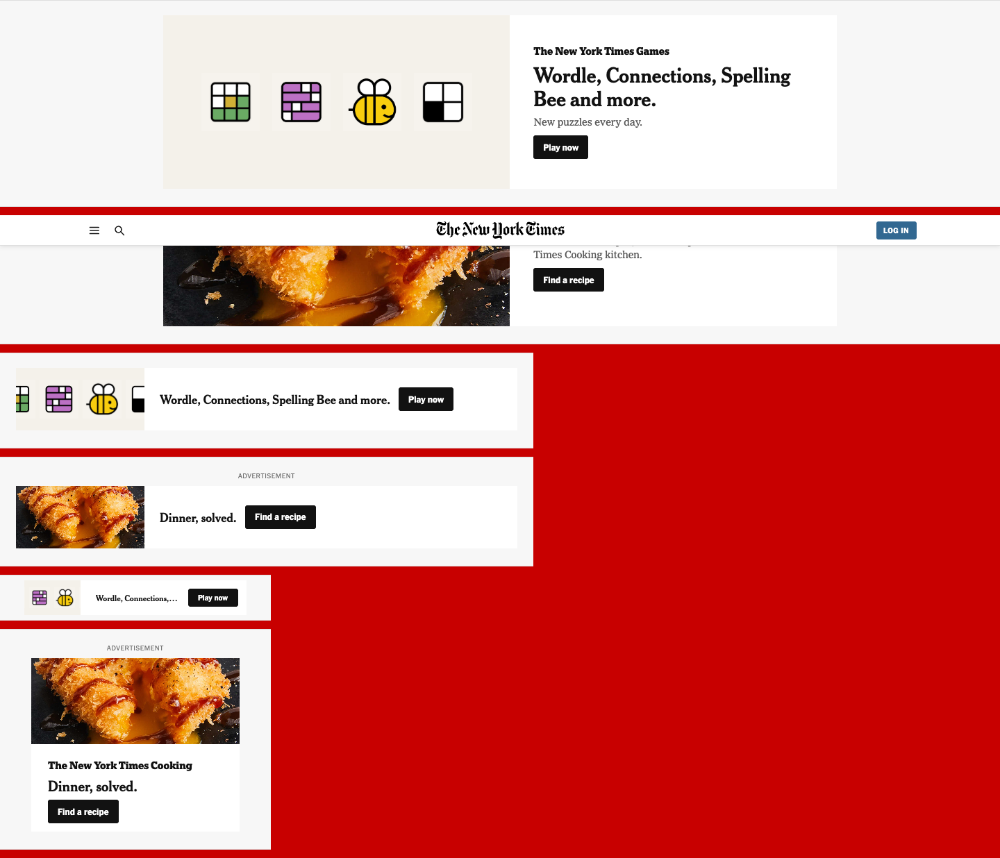

# Building the New York Times front page in Declare

*Report · November 7, 2026 · written by Claude (Opus 5.5) after building the app in one Claude Code session (~12:28–17:30 PST)*

An exercise in cloning nytimes.com's look and behavior (layout, type, rules, pictures, responsive design, menus, carousels) as an idiomatic Declare program. What worked, what didn't, what it costs, and what it was like to do as an AI agent.

- **Running app (dev server, live compile):** <http://127.0.0.1:8240/app/nyt.declare> (add `?inspector` for the Inspector)
- **Production build (precompiled, gzip):** <http://127.0.0.1:8250/>. This is a small local static server I started for measurement. If it's gone, serve `dist/` from any static host.
- **Project:** `/Users/temkin/Code/nyt-declare/`. The full step-by-step log is `LOG.md` there. This report is also at `REPORT.html` and `~/Desktop/Declare-NYT-Report.html`.

---

## 1. Summary

- **It works, and it's close.** At 1440px the clone lines up with the archived NYT page:
  - the masthead, edition links, section nav with hover mega-menus and the double rule;
  - the boxed "free to read" lead and the 33px column grid with hairlines;
  - the Opinion rail;
  - story packages with labels and sub-links, inline muted videos and the weather strip;
  - full-width sections: Watch, More News, Well, Shows, Culture, The Athletic, Cooking, Wirecutter, Games;
  - a site index and footer.

  It adapts to desk (≥1024), tablet (740–1023) and phone (<740) layouts. It has a sticky condensed bar, a sections drawer and paging carousels, and all text is selectable.
- **Small source.** About **855 lines of Declare code** in 4 files with 71 classes (1,332 lines including comments and blank lines; 69 KB raw, 17 KB gzip). There is no CSS, and no JavaScript of my own beyond the expressions. The content is 140 KB of JSON that I extracted.
- **Fast in production on a desk.** The build ships one 202 KB (gzip) module.
  - Desktop, cold load: first contentful paint ≈115 ms, LCP ≈360 ms, 25 requests, about 1.0 MB in total.
  - Throttled phone profile: FCP ≈3.0 s and LCP ≈4.5 s. The limit is that the JS bundle must download and run before anything paints.
- **The tooling is the standout.** The compiler's errors name the fix. `declare-verify`'s ladder (through the behavior rung: real input, 21 assertions), `declare-look` and `declare-help` made an unfamiliar language workable for an agent within an hour.
- **Main gaps I hit:**
  - No server-rendered paint: the crawler document isn't shown to readers.
  - No built-in lazy or responsive images; I wrote lazy loading myself.
  - Every face of a `Font` downloads.
  - A scroller can't report its scroll extent when a layout sizes its children.
  - Hover events and "pointer out" semantics take care to get right.
  - Heading semantics are inferred from type size.
- **Would I use it for a site like this?** For an interactive, app-like news front page, yes, with caveats. For a page whose business depends on first paint on slow phones, SEO and ad tech, not until it can render the page's real HTML before the JavaScript runs and has an image pipeline (§11).


*Left: the NYT snapshot (Oct 21, 2026, rendered from the Wayback copy). Right: the Declare clone. The hamburger, search, Log In and date are drawn by the live site's client code, so the snapshot lacks them; the clone includes them.*

---

## 2. What was built, and how

### Scope and sources

- **Reference.** nytimes.com blocked headless Chrome as a bot, and I did not try to evade that. The Wayback Machine's recent captures were themselves captcha pages, but the 2026-10-21 capture was real. I rendered that HTML locally against NYT's static CDN, as a *visual reference only*.
- **No NYT code was copied.** I measured rendered text metrics (font, size, weight, leading, tracking, color), rule lines and column geometry, the way a designer reads an inspector. These became the theme tokens and type classes. I read the font stylesheet only for its font-file URLs.
- **Content** (headlines, summaries, kickers, credits, URLs, nav menus) came from the snapshot's preloaded data and rendered text. The sections NYT fills per visitor (Well, Shows, Culture, Athletic, Cooking, Wirecutter, Most Popular) came from *archived* NYT RSS feeds of the same week. Everything is in my own JSON schema.
- **Assets are local:** 12 web-font faces (NYT Cheltenham, Franklin, Imperial, Karnak), 3 SVG logos, about 95 images at real NYT rendition sizes, and 2 package videos (480p).
- **Ads:** real ad creatives are served live by an ad network, and none were archived. Fetching live ones would mean generating fake impressions. The slots hold *house ads* instead, built from NYT's own assets, in IAB sizes per device: billboard 970×250, leaderboard 728×90, banner 320×50, rectangle 300×250.

### Program structure (the Declare way)

- **Data:** `data/home.json` (packages, rail, sections, ads) and `data/nav.json`. Both are typed by `schema`s and loaded by two `DataSource`s.
- **State on the App:** `menuId`, `navHoverId`, `menuHover`, `drawerOpen`, `drawerSectionId`. Derived from width and scroll: `wide`/`mid`/`phone`, `pageW`, `stuck`, `menuOpen`.
- **Records of different kinds are different classes,** picked by `classFor` lookups:
  - packages: `NewsPackage`, `FreeBox`, `ElectionStrip`, `PollsBar`, `TipStrip`, `WeatherStrip`;
  - columns: `StoryCol`, `ImageCol`, `PairCol`, `VideoCol`;
  - story sizes, rail blocks and sections work the same way.
- **Two layouts of my own:**
  - `Columns`: NYT's span-weighted column grid with 33px gutters and optional gutter hairlines. On a phone it stacks columns by an `order` field, so a photo that sits right of its story on a desk comes first.
  - `Strip`: a carousel row with N cards per page, in a natively scrolling pane.

  The top-level main/rail split and the full-vs-compact masthead are `ResponsiveLayout`s.
- **Look:** a `Times` theme laid over the library's `SanFrancisco` preset. The voices (Kicker, Summary, Meta, Credit, PackageLabel and so on) are `Text` subclasses. Marks are drawn `Icon`s, plus the library's `ChevronIcon`.
- **One set of nav records, four renditions:** the nav bar, its hover mega-menus, the drawer and the footer site index.


*The same program at 1440px (left, ⅕ scale) and 390px (right). On the phone the media stacks above its story, the rail follows the main column, and the strips scroll sideways.*


*The Opinion hover menu, replicated from nav.json. It opens after 160 ms of hover intent, switches instantly between sections, and closes 220 ms after the pointer leaves the item and the panel. Esc also closes it.*


*House-ad creatives: billboard (desk), leaderboard (tablet), banner and rectangle (phone). It's one class whose layout plan reads its format.*

---

## 3. What worked well

- **The model fits a content page.** "Records in datasets, the reader's place on the App, views derived from both" mapped directly onto a front page. Replicating over `:packages[]` with a `classFor` lookup made each package kind a small class. The page never needed a loop or a render function.
- **Layout without CSS was easier, not harder.**
  - NYT's grid is a 30-line `Layout` with one `place()`, which I could reason about completely.
  - The "one decider per value" rule, enforced by the compiler refusing double deciders, stopped a whole class of CSS confusion.
  - `ResponsiveLayout`'s `share: 0` is a clean way to say "this isn't here at this width".
- **Diagnostics that name the fix.** Nearly every compile error told me exactly what to write instead:
  - use a `State` for an arrangement-specific width;
  - quote enum values inside `{ }`;
  - schemas and classes share a namespace;
  - `Carousel` is a library class, so rename yours.

  I applied them without needing to understand the internals.
- **The verify ladder.** Structure → resolution → typecheck → boot → behavior, stopping at the first real problem. The behavior rung drives the real app with real input and asserts by view path. It also runs layout checks wherever the script settles, which caught real bugs:
  - weather rows overflowing at tablet width;
  - a mega-menu category running off its panel;
  - a nav item that took no pointer in the gap beside its chevron.
- **States instead of conditionals.** `State [ applied = { app.phone }, width = 100% ]` reads well and can't leak.
- **Fonts as objects.** NYT's web fonts are `Font [ FontFace … ]` on the App, with fallback stacks as values. There's no `@font-face` and there are no loading classes, and text re-measured when the fonts arrived.
- **Overlays.** The sections drawer is a `Sheet` with `shown` and `input`. Closing on Esc, on an outside press and with its own motion needed no code of mine.
- **Media as state.** `playing = { this.onScreen && app.pageVisible }` is the whole autoplay policy for the inline videos.
- **The production build is small, and its report is honest.** `declarec` says exactly what it kept (16 of 27 runtime classes; capabilities cut). 202 KB gzip for the runtime plus this program is competitive.

---

## 4. What was harder

- **Hover intent.** A mega-menu that opens on hover and survives the trip from item to panel took three designs:
  1. `trackChanges=["hovered"]` alone failed, because a plain View has no pointer interest in the gap beside its chevron.
  2. `onPointerOver`/`onPointerOut` failed, because events don't bubble. Out fires when the pointer moves onto the item's own label, and over doesn't fire at all when the pointer lands on a child.
  3. The final design uses `hovered` (true across the whole subtree) for entry and exit, and declares `onPointerOver` so the item's own background takes the pointer.

  It's correct, and well explained in the docs once you know. But it isn't obvious. A library "hover intent" helper, or a `Menu` that opens on hover, would remove the most error-prone part of building a site nav.
- **Carousel end detection.** I needed "is the row scrolled to its end?", and nothing in Declare answers that directly:
  - A scroller's `contentWidth` reads **0** when a layout sizes its children, because they don't count toward auto-extent. There is no scroll-range fact.
  - My first fix moved the cell arithmetic into the view. The user rightly pointed out that this is the drift the skill warns against.
  - The library's pattern (`CarouselLayout.laidCount()`) suggested exposing the arithmetic from the layout instead. But a constraint can't read through `laid()`/`contentExtent()` (`DECLARE7001`).
  - The final idiom: the layout exposes pure methods `cell(room)` and `run(room, cards)`, and the view passes the pane width and the data's count.

  It works, but a `scrollRangeX`/`scrollRangeY` fact on scrollers would make this one line.
- **Heading semantics and crawl output.** The crawler document infers heading levels from type size, so the house ad's 30px title became the only `<h1>`, with 83 `<h5>`s. The screen-reader tree shows headlines as plain text. Declare has `accessibilityRole`/`accessibilityLevel` to fix this, but I didn't add them. This is the most important unfinished item (§12).
- **Reading a lot first.** The skill requires about 3,600 lines of reading before writing anything: the spec, four guide chapters and a whole app. It's the right call, and it paid off, but it's a real up-front cost. I read about 2,000 more lines of guide chapters as features came up.
- **Verify with real data.**
  - Rung 4 boots with *schema samples*, not the program's JSON.
  - Rung 5, run against verify's hosted copy, couldn't find `data/home.json` (the replicated nav was empty after `settleData`). I had to pass `--url` so it drove the dev server's copy.
  - The default R5 window is narrower than a desk, so my desktop-only masthead was dropped until I exported `device`.

  Each message was clear. It just took several round trips to learn.

---

## 5. Surprises

### Good

- How little code a dense, responsive page takes once the grid is a layout: about 855 lines, for something NYT ships 600+ KB of JS modules and 160 KB of CSS for. (Not like-for-like: their page does far more.)
- `classFor` with an object-literal lookup (`({ lead: LeadStory, great: GreatStory })[:size] ?? Story`) type-checks, and it keeps the choice in data instead of nested ternaries.
- A `ResponsiveLayout` plan is a constraint, so it can read `app.wide` directly. That fixed the case where the header's own width (962) fell under the breakpoint in a 1024px window.
- The production builder ships a WebAssembly constraint kernel and tree-shakes down to the classes the program uses.
- Text selection was one attribute: `selectable = true` on the App, provided down the tree.

### Bad

- **Nothing paints before the bundle runs.** The dev page and the production `index.html` are an empty `<div>` until then. The crawler build bakes 54 KB of semantic HTML into the page, but that HTML is for crawlers. Screenshots 1.5 s into a throttled phone load are blank for both builds, so Lighthouse-style FCP for the crawler build (244 ms) is misleading.
- **Every face of a reached `Font` downloaded, used or not.** That was 26 files / 632 KB until I pruned to 12 faces / 291 KB. The docs' "a font loads when text reaches it" holds per font, not per face.
- **No lazy or responsive images.** `Image` has one `source`, no `srcset`, no `loading`. My first cold load fetched **95 images, 22.7 MB**; NYT's page fetched 46 images, 482 KB. Lazy loading took 6 lines (§8), but every content site will need it.
- **Wildcard replication built nothing.** JSONPath `:columns[*].items[]` (replicating across a wildcard) produced no rows, so I had to nest the replication. That may be intended, but the docs list `[*]` among the supported selectors.
- **A fragment on an external link was refused.** A literal `"#commentsContainer"` fragment was rejected as an unknown in-app anchor (`DECLARE2000`). The link checker is a great feature, but it shouldn't judge fragments meant for another site.
- **`HTMLText` has no `textAlign`.** A centered line of rich text ("**Got a Tip?** The Times offers…") needed a `wrapWidth` workaround.

---

## 6. Gaps and limitations (for a site of this kind)

| Area | Gap | What I did |
|---|---|---|
| First paint | No server-rendered or visible static HTML; paint waits for the bundle | Measured it (§8) |
| Images | No `srcset`/DPR selection, no lazy loading, no intrinsic aspect from metadata | Wrote lazy loading (an `onScreen` latch); set aspect from data |
| Fonts | All faces in a Font download | Pruned faces by hand |
| Scrolling | No scroll-range fact; `contentWidth` 0 for layout-sized children | Layout exposes pure arithmetic methods |
| Hover menus | No hover-intent primitive; events don't bubble; out fires on moving to a child | `hovered` + `onPointerOver` + `afterDelay` |
| Semantics | Headings inferred from size in crawl output; plain text in the a11y tree | Not yet fixed; needs `accessibilityRole = heading` + level |
| Ads / third-party | Real ad tech (GPT, prebid) would need a `DOMIsland` or script glue | House ads as Declare views |
| Rich text | `HTMLText` lacks `textAlign` | `wrapWidth` + `x = center` |
| Tooling | `declare-look` has no hover action (assert scripts do); `reveal` gives up after 8 swipes on long pages | `--wheel` before `--shot-of`; hover tested in R5 |

---

## 7. Bugs and friction worth filing

1. **Wildcard replication:** `datapath = :columns[*].items[]` produced no rows, while nested replication works. Either fix it, or document that `[*]` doesn't flatten for replication.
2. **External fragment links** are rejected as unknown anchors (`"…html#commentsContainer"` built in a constraint). The checker should only judge fragments of the app's own location.
3. **Crawl heading inference** made an ad the page's `<h1>`. Consider requiring an explicit heading role for `h1`–`h3`, or warning when the largest text sits in a link or an ad-like subtree.
4. **Font faces** all load as soon as any text reaches the Font. Per-face loading would match the docs and save hundreds of KB on type-rich sites.
5. **A scroller's `contentWidth`** reads 0 when a layout sizes its children, even though its scroll range is real. Either count laid-out boxes, or add a scroll-range fact.
6. **verify R5 hosting:** relative `DataSource` URLs (`data/home.json`) didn't resolve in verify's hosted copy; the nav emptied after `settleData`, and `--url` was required. If that's by design, the R5 message could suggest `--url`.
7. **The dev server** returns 404 for a `declarec` output folder inside the project (`/dist/`), so you can't preview a production build with the same server. A `declare-dev --serve dist`, or passing `/dist/` through, would help.
8. **Docs nit:** `onPointerOut` fires on entering a child. That deserves a sentence beside `onPointerOver`'s, steering hover logic toward `hovered`.

---

## 8. Performance

**Method.** Puppeteer plus the Chrome DevTools Protocol, cold cache, one browser per run.

- **Desktop:** 1440×900, unthrottled.
- **Phone:** 390×844, 150 ms RTT, 1.6 Mbps down, 4× CPU slowdown.
- The production build was served by a small gzip static server.
- **The machine was heavily loaded during measurement**, so treat millisecond figures as indicative; repeat runs varied by about ±10%. Byte and request counts are exact.
- Raw data: `capture/perf-run1…4.jsonl`.

### Final production build vs. the NYT snapshot

| Metric | Declare prod — desktop | Declare prod — phone | NYT snapshot — desktop | NYT snapshot — phone |
|---|--:|--:|--:|--:|
| First contentful paint | 112–120 ms | 2.97 s | ≈1.0 s | 3.0 s |
| Largest contentful paint | ≈360 ms | 4.5 s | ≈1.0 s | 3.1 s |
| Lead headline in page | 290–325 ms | 2.93 s | ≈0.95 s | 3.1 s |
| DOMContentLoaded | ≈80 ms | 1.5 s | 1.3–1.9 s | 14.9 s |
| Requests (to network idle) | 25 | 25 | 185 | 185 |
| Transferred | 1.0 MB | 0.94 MB | 8.0 MB | 8.0 MB |
| — JavaScript | 202 KB (1 file) | 202 KB | ≈2.0 MB (67–70 files) | ≈2.0 MB |
| — HTML / CSS | 0.3 KB / 0 | — | 1.55 MB / 142 KB | — |
| — Fonts | 291 KB (12) | 291 KB | 293 KB (12) | 297 KB |
| — Images / video | 479 KB (8) / 0 | 412 KB | 482 KB (46) / 3.5 MB | — |
| — Data (JSON) | 34 KB gz | 34 KB | inline in HTML | — |
| Long tasks (main thread) | 1 × ≈175 ms | 5, 1.3 s total | 0 | 9, 0.96 s total |
| JS heap after load | 16–23 MB | 18 MB | 26 MB | 25 MB |
| DOM elements | ≈1,920 | ≈1,850 | ≈6,200 | ≈6,200 |

**Caveats on the NYT column.** The comparison shows shape, not a verdict:

- The snapshot's HTML came from `file://`, so its 1.55 MB document cost no network time. All its other files came from NYT's real CDN over the internet.
- Much of its JavaScript (ads, analytics, personalization) partly fails offline.
- The lower sections it would normally fetch per visitor aren't counted.

So the snapshot gets its HTML faster, and does less work, than the live site.

### What changed along the way (measured)

| Step | Requests | Transfer | Note |
|---|--:|--:|---|
| First measurement, every image loaded eagerly | 92–134 | 12.9–23.7 MB | 95 images / 22.7 MB at startup |
| Lazy `Picture` + lazy video (`onScreen` latch) | 39 | 1.35 MB | the 8 images in view load first |
| Pruned unused font faces (26 → 12) | 25 | 1.0 MB | fonts 632 → 291 KB |

The lazy loader, written the Declare way, is 6 lines:

```declare
class Picture extends Image [ stretches = cover, fill = { this.loaded ? null : provided("theme").skeleton },
    src: string = "",
    seen: boolean = false,
    trackChanges = ["onScreen"],
    onChange() { if (this.onScreen) seen = true },
    source = { this.seen ? this.src : "" }
    ]
```

### Readings

- **Desktop:** excellent. The bundle is one request and parses fast, and the page is complete in about a third of a second. On a desk this beats the NYT snapshot's first paint by roughly 8×, partly because the clone does much less.
- **Phone:** this is the weak spot.
  - Nothing can paint until about 200 KB of JS has downloaded and run on a slow CPU, so FCP is about 3 s.
  - NYT's server-rendered HTML paints at about the same time over a much heavier page. On the real network (not `file://`), its HTML would cost more.
  - Declare's crawler document would close this gap if it were *visible* and the runtime replaced it in place at boot (progressive enhancement). Today it's for crawlers only.
- **Runtime cost:** about 1,900 DOM elements (vs about 6,200 for NYT) and a heap under 25 MB. On desktop, one main-thread task of about 175 ms covers the initial build and settle of the whole tree.
- **Dev mode** (in-browser compile, cached): FCP ≈210 ms, ready ≈410 ms on desktop. The dev server also serves a compiled program, so dev feels close to production.
- **Build:** `declarec` takes 3–6 s on this program. The bundle is 705 KB raw / 201 KB gzip, including the program's 158 KB of JSON. `--crawler=true` adds 14 KB gzip of semantic HTML.

---

## 9. Code size compared with nytimes.com

| Item | Declare clone | NYT homepage (bytes shipped) |
|---|--:|--:|
| UI source | 855 code lines / 1,332 total; 69 KB raw, 17 KB gzip; 4 files, 71 classes | not visible (not read) |
| — `nyt.declare` (App, fonts, state, page tree) | 123 code / 216 lines | |
| — `nyt-parts.declare` (schemas, layouts, stories, packages, rail, sections) | 417 / 621 | |
| — `nyt-chrome.declare` (masthead, nav, menus, sticky, drawer, ads, footer) | 236 / 342 | |
| — `nyt-type.declare` (theme, voices, drawn marks) | 79 / 153 | |
| JavaScript shipped | 202 KB gz (runtime + compiled program) | 9 scripts (284 KB) + 45 modules (328 KB) + ≈400 KB inline code, uncompressed |
| CSS | none | 34 sheets (126 KB) + 41 KB inline |
| Page data | 140 KB JSON (34 KB gz) | ≈700 KB JSON inline in a 1.59 MB HTML |

Not part of the app: the content extractor `tools/build_content.py` (478 lines), `tools/nytindex.py` (51), and the behavior test `tests/flow.mjs` (66 lines).

---

## 10. Declare compared with other approaches

| Compared with | Where Declare is better | Where it's worse |
|---|---|---|
| **React / Next.js** (what NYT uses) | No render/re-render, hooks or dependency arrays; layout as objects instead of CSS; the compiler type-checks the whole tree and data paths; far less code; motion and states are first-class. | No SSR or streaming HTML; no `next/image`-style responsive images; a tiny ecosystem (no off-the-shelf ad, analytics or consent integrations); a new language for every contributor. |
| **Svelte / SvelteKit** | Similar "the compiler does the reactivity" spirit, but Declare also owns layout and the typing of data paths, and its diagnostics are better. | SvelteKit has SSR, hydration, CSS scoping, a router, and the web's whole CSS toolbox when you want it. |
| **Qt QML** (closest relative) | Very similar model: a declarative tree, JS expressions as bindings, states and layouts. Declare adds static typing of bindings and data, a web-first renderer, crawler extraction and agent-oriented tooling. | QML has a mature control library and decades of production use. |
| **SwiftUI / Jetpack Compose / Flutter** | The same "layout is a typed object, no CSS" ergonomics, but it targets the web natively (real DOM, selection, links, accessibility tree) and needs no build step in dev. | Smaller widget catalogs; less tooling for performance-critical, content-heavy pages. |
| **Plain HTML + CSS** | Grids, responsive changes, and menus and carousels with behavior took a fraction of the effort, and are checked by a compiler. | Static HTML paints immediately and is indexable by default; the platform gives you lazy images, `srcset` and font subsetting for free. |
| **Elm** | A similar emphasis on helpful compiler errors and a single source of truth, but constraints instead of message-passing boilerplate, and layout built in. | Elm's architecture is more explicit about effects; Declare's reactivity is easier to write but harder to audit at scale. |

---

## 11. Would I use Declare for a site like this?

**For a section of a news site that behaves like an app** (live election results, a data-rich interactive, a games hub, a personalized front page behind a login): yes. It was faster to build and easier to make correct than the React equivalent would have been, and much smaller. The constraint model, layouts, states, springs and the verify loop are a real productivity gain.

**For the public nytimes.com front page itself: not yet.** That page succeeds or fails on first paint on a cheap phone, SEO, and integration with ad tech, consent and analytics vendors. It would need:

1. A **visible pre-rendered document** that the runtime takes over in place (or true SSR).
2. An **image pipeline**: `srcset`/DPR selection, lazy loading by default, aspect reservation.
3. **Per-face font loading**.
4. **Explicit heading and landmark semantics**, enforced or at least linted.
5. A documented pattern for **third-party tags** (GPT ads, consent) inside `DOMIsland`s.

None of these look architecturally hard, given what's already there: the crawler document exists, and the lazy loader was 6 lines.

---

## 12. What's not finished in the clone

- Heading and landmark semantics: `accessibilityRole = heading` with levels on headlines, plus `navigation`, `main` and `complementary` landmarks.
- A behavior pass on a touch device (R5 with `device: { touch: true }`): the drawer, the sticky bar, swiping the shelves.
- Real ad creatives. These need captures from a real browser session.
- Pixel-level tuning of some section spacing against the reference. Most of the lower sections had no reference content to compare, because NYT fills them per visitor.
- Responsive image renditions. The data carries one rendition per image, often 1500px, which is heavier than thumbnails need.

---

## 13. Working with Declare as an AI agent

Declare is explicitly designed for agents, and it shows. The parts that mattered most:

- **The skill file** (`skill/SKILL.md`) is the best onboarding I've seen for a new language. It includes:
  - what to read, in what order, and how to plan;
  - a table of "what Declare handles for you", with the guide section for each need;
  - a **drift check**: the ways a working program can still end up written in another framework's shape.

  It also warns that resemblance to React/CSS is the main source of mistakes. That was accurate: most of my errors were CSS or React instincts (a bare `textAlign`, `width = null`, a child named `clip`, hover via out-events).
- **`declare-help`** answered every "does this exist?" question in a second: members, types, events, library classes, error codes. It led me to `ChevronIcon`, `Sheet`, `pageVisible` and `afterDelay`, and to the library's `Carousel` (which I decided not to use). Asking before guessing paid off every time.
- **Errors written for the next action.** Every compiler message named a fix I could apply mechanically. That is what made the write → verify → fix loop converge quickly: about 15 verify runs took the program from first draft to clean through R4.
- **Introspection beats re-reading source.** When R5 failed, I could ask the running program questions with `declare-look --read`, `--outline`, and a 10-line debug script using `__declare.find`. That's how I found `contentWidth = 0`, and that `navHoverId` was never set. The guide says "don't re-read the source to guess: ask the running program", and that was the right advice.
- **Assert scripts address views by path** (`app.header.full.nav.1`, `app.lower.0.shelf.next`), which is robust for an agent: there are no CSS selectors to guess. The rung also runs layout checks in each settled state, which catches what screenshots hide.
- **Where it was harder for me:**
  - *The tools don't catch drift.* My carousel workaround passed every rung; the human reviewer caught it. A lint for "arithmetic that divides a parent's width among siblings outside a layout" (a pattern the skill already describes) would have flagged it.
  - *R4 boots with sample data,* so the program that boots in verify isn't the one the user sees. The note says so, but my first R5 failures came from not internalizing it.
  - *Long reads up front* (thousands of lines) consume context, and if the session is summarized the skill says to re-read. A condensed "agent card" of about two pages (the seven differences, the drift list, the top 20 error codes) would help long sessions.
  - *Screenshots are still the agent's eyes.* `declare-look` captures only the window. A full-page or `--shot-of app` long capture, plus a hover action, would have saved the custom puppeteer scripts I wrote.

**Overall:** a productive experience. In roughly five hours I captured and extracted the content, learned the language, wrote and verified the program at three widths with tested behavior, and measured it. I'm confident it would have taken longer to reach the same verified state in React with CSS, mostly because Declare's compiler and verify ladder rejected wrong code early instead of letting it render subtly wrong.

---

## 14. Notes for the Declare maintainers

1. Make the crawler document a **visible first paint** that the runtime adopts in place. It's the single biggest win for content sites.
2. Give `Image` **`srcset`/`sizes`-like rendition selection** and **lazy loading by default**. An `onScreen` latch is already the idiom.
3. **Load fonts per face**, or at least have verify list the faces no text uses.
4. Add a **`scrollRangeX`/`scrollRangeY`** fact on scrollers, and/or have `contentWidth` count layout-placed boxes.
5. Add a **hover-intent primitive**: a `Menu`/`Popover` that opens on hover, with enter/leave delays and a safe zone. Every site nav needs one, and it's the hardest thing to get right by hand.
6. **Semantics:** warn when the crawl output's `<h1>` sits inside a link or an ad-like region, and make `accessibilityRole = heading` + level easy to find from the `Text` reference.
7. Fix or document **`[*]` in replicating datapaths**, and let **external URLs with fragments** through the link checker.
8. Add `textAlign` to `HTMLText`/`RichText`.
9. **Verify:** suggest `--url` when R5 data sources fail in the hosted copy, state the R5 default window in the output, and consider letting `declare-dev` serve a `declarec` output folder.
10. **Lint for drift.** The drift list in the skill is excellent, and several of its tells (equal widths by arithmetic, a long script block, color constants) look mechanically detectable.
11. **`declare-look`:** add `--hover PATH` and a full-page capture.

---

## 15. Files and artifacts

| What | Path |
|---|---|
| Program (entry) | `/Users/temkin/Code/nyt-declare/app/nyt.declare` |
| Parts, chrome, type | `app/nyt-parts.declare`, `app/nyt-chrome.declare`, `app/nyt-type.declare` |
| Data | `app/data/home.json`, `app/data/nav.json` |
| Assets | `app/assets/{fonts,img,video,logo}/` |
| Behavior test (R5) | `tests/flow.mjs`; run `npx declare-verify app/nyt.declare --assert tests/flow.mjs --url http://127.0.0.1:8240/app/nyt.declare` |
| Content tooling | `tools/build_content.py`, `tools/nytindex.py` |
| Production builds | `dist/` (plain), `dist-crawl/` (with crawler document) |
| Step-by-step log | `LOG.md` |
| This report | `REPORT.md`, `REPORT.html`, `~/Desktop/Declare-NYT-Report.html` |
| Reference captures | `capture/` (snapshot HTML, preloaded data, screenshots, text-metric dumps, RSS, perf JSON) |
| Clone screenshots | `shots/` (e.g. `final-top.png`, `v5-ov0.png`, `look-menu3.png`, `look-drawer3.png`, `ads-all.png`, `cmp-top.png`) |
| Declare distro used | `vendor/declarelang` @ 81d494e (v0.6.4), linked as a devDependency |
| Dev server | `cd /Users/temkin/Code/nyt-declare && npx declare-dev` → <http://127.0.0.1:8240/app/nyt.declare> |

Measurement and capture scripts (shoot, dump, slice, side-by-side, perf, early, gzserve, adprobe) live in this session's scratchpad: `/private/tmp/claude-503/-Users-temkin-Code-nyt-declare/aed2a4fb-5fc7-4bf9-86ec-5fd76c9e0c42/scratchpad/tools/`.
